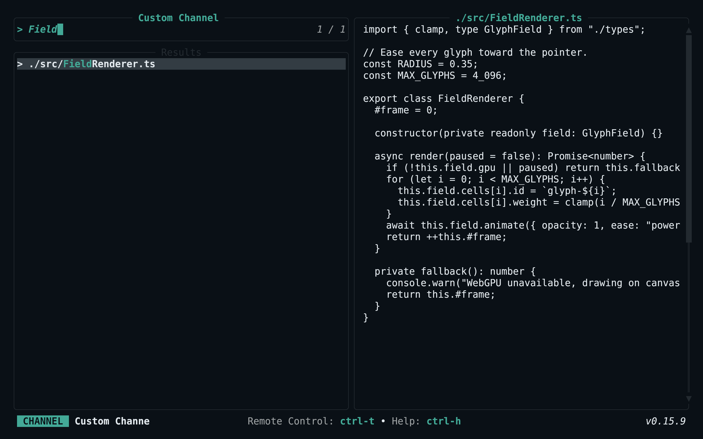
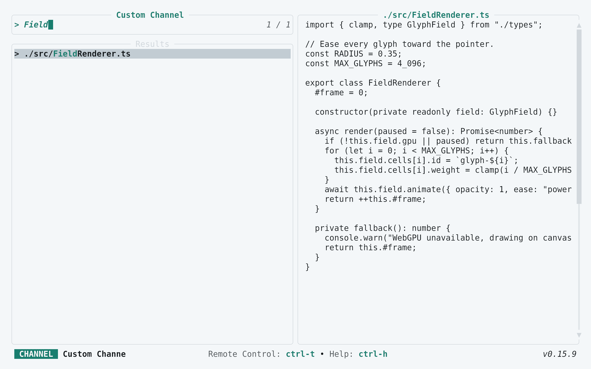

<!-- living-code-readme:1 -->
# 📺 Living Code for Television

**Calm slate. Living color.** Living Code for Television: complete native TOML palettes for search results, matches, previews, selections and mode indicators.

[Installation](#installation) · [Flavors](#flavors) · [Configuration](#configuration) · [All ports](https://github.com/living-code-theme)

## Previews

<table data-lc-flavors>
<tr>
<td width="50%" valign="top">
<strong>Night</strong><br><sub>Dark · full palette</sub><br><br>
<a href="images/night.png"></a>
</td>
<td width="50%" valign="top">
<strong>Frost</strong><br><sub>Dark · softer chroma</sub><br><br>
<a href="images/frost.png"></a>
</td>
</tr>
<tr>
<td width="50%" valign="top">
<strong>Paper</strong><br><sub>Light · near-white slate</sub><br><br>
<a href="images/paper.png"></a>
</td>
<td width="50%" valign="top">
<strong>Signal</strong><br><sub>Dark · teal accent</sub><br><br>
<a href="images/signal.png"></a>
</td>
</tr>
</table>

Select any preview to view the image at full size.

## Installation

```sh
flavor=night # night, frost, paper, or signal
curl -fsSL --create-dirs -o "${XDG_CONFIG_HOME:-$HOME/.config}/television/themes/living-code-$flavor.toml" "https://raw.githubusercontent.com/living-code-theme/television/main/themes/living-code-$flavor.toml"
```

Set the downloaded filename stem in the existing `[ui]` table of Television’s `config.toml`:

```toml
[ui]
theme = "living-code-night"
```

Restart `tv`. Preserve other config settings; if you use a different Television config directory, put `themes/` beside that `config.toml`.

## Flavors

Expand a flavor for its full-size preview and activation instructions.

<details data-lc-flavor="night">
<summary><strong>Night</strong> · Dark · full palette</summary>

<p><a href="images/night.png"></a></p>

Set `theme = "living-code-night"` in the existing `[ui]` table and restart `tv`.

</details>

<details data-lc-flavor="frost">
<summary><strong>Frost</strong> · Dark · softer chroma</summary>

<p><a href="images/frost.png"></a></p>

Set `theme = "living-code-frost"` in the existing `[ui]` table and restart `tv`.

</details>

<details data-lc-flavor="paper">
<summary><strong>Paper</strong> · Light · near-white slate</summary>

<p><a href="images/paper.png"></a></p>

Set `theme = "living-code-paper"` in the existing `[ui]` table and restart `tv`.

</details>

<details data-lc-flavor="signal">
<summary><strong>Signal</strong> · Dark · teal accent</summary>

<p><a href="images/signal.png"></a></p>

Set `theme = "living-code-signal"` in the existing `[ui]` table and restart `tv`.

</details>

## Configuration

A theme file has flat color keys; `[ui]` belongs only in `config.toml`. Existing `[ui.theme_overrides]` entries override the installed palette, so remove conflicting values if the colors do not match. The port sets both foreground and background on selected results and every mode badge.

## Compatibility

Targets Television’s documented flat TOML custom-theme API and all required fields in its `Theme` struct. The `send_to_channel_mode_fg` fallback in newer documentation is not needed by the pinned contract. Truecolor is recommended. Tests check the full required field set, native parsing, semantic colors and selected-row contrast.

Previews are captured programmatically from the actual application in an isolated profile. See [`capture/app.py`](capture/app.py) for the app-owned recipe and [`images/capture.json`](images/capture.json) for runtime, palette and image provenance. No mock interface is drawn.

## Contributing

Found a problem? [Open an issue](https://github.com/living-code-theme/television/issues/new/choose) with the app version, the flavor and a screenshot. Want Living Code somewhere else? [Request a port](https://github.com/living-code-theme/core/issues/new?template=port-request.yml).

Pull requests are welcome. Keep this README, `port.json` and `images/` in sync, and use real screenshots of the app, never mockups.

🦎 **One chameleon, many habitats.** Part of [Living Code](https://github.com/living-code-theme).

## License

[MIT](LICENSE) © Elliot Luque
